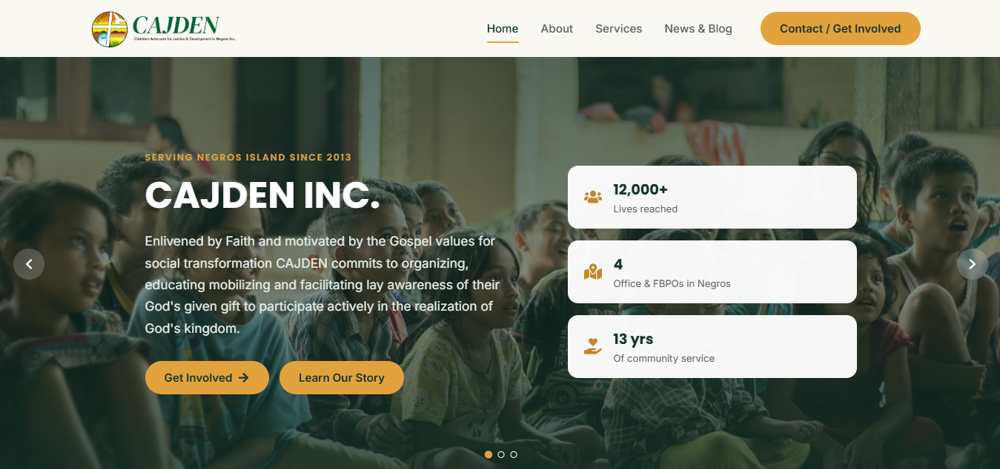
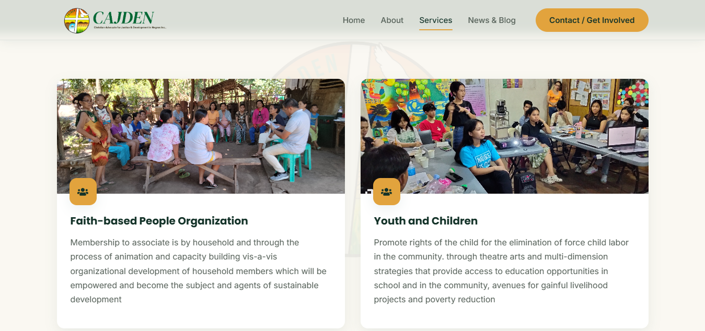
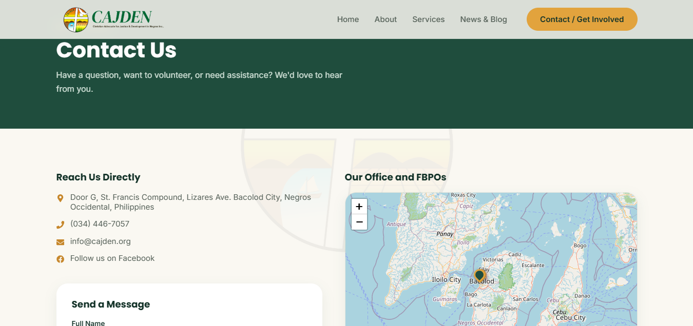

# Christian Advocates For Justice and Development in Negros — NGO Website Management System

A 5-page NGO website (Home, About, Services, News & Blog, Contact) with a secure
admin panel, built with React (frontend), PHP REST API (backend), and MySQL.

## Project overview
<p align="center">
  
  
</p>

<p align="center">
  
</p>

## Project structure

```
ngo-project/
├── backend/          PHP REST API + MySQL
│   ├── api/           Public endpoints (posts, services, officers, offices, contact, settings)
│   ├── api/admin/      Admin-only endpoints (dashboard, messages, reorder officers)
│   ├── config/db.php   Reads DB credentials from .env
│   ├── .env.example    Template — copy to .env and fill in real secrets
│   ├── .env            Your real local secrets (gitignored, not committed)
│   ├── includes/       Shared bootstrap, auth, upload helpers
│   ├── uploads/        Uploaded images (officers, services, posts)
│   └── schema.sql      Full database schema + seed data
└── frontend/          React (Vite)
    └── src/
        ├── pages/       Home, About, Services, NewsBlog, PostDetail, Contact
        ├── pages/admin/ Login, Dashboard, and management screens
        └── components/  Navbar, Footer, OfficeMap (Leaflet), Hierarchy, etc.
```

## 1. Backend setup (XAMPP)

1. Copy the `backend/` folder into `htdocs/ngo-project/backend` (XAMPP), so the
   API is reachable at `http://localhost/ngo-project/backend/api/...`.
2. Start Apache and MySQL in the XAMPP control panel.
3. Open phpMyAdmin, create nothing manually — just import `backend/schema.sql`
   (it creates the `ngo_db` database, all tables, and seed data for you).
4. Copy `backend/.env.example` to `backend/.env` and fill in your real values:
   - `DB_HOST` / `DB_NAME` / `DB_USER` / `DB_PASS` — your MySQL credentials
     (defaults to XAMPP's `root` with no password).
   - `APP_FRONTEND_URL` — must exactly match the URL your React app runs on
     (protocol + host + port, e.g. `http://localhost:5173`). This is what
     controls CORS, so a mismatch here is the #1 cause of CORS errors.
   - `GMAIL_ADDRESS` / `GMAIL_APP_PASSWORD` / `CONTACT_RECEIVER_EMAIL` — see
     step 6 below for how to get a Gmail App Password.

   `backend/.env` is gitignored and holds real secrets — never commit it.
   `backend/.env.example` is the template that's safe to commit.
5. Install PHPMailer (used by the contact form to email your Gmail inbox):
   ```bash
   cd backend
   composer require phpmailer/phpmailer
   ```
   If you don't have Composer, download PHPMailer manually from
   https://github.com/PHPMailer/PHPMailer and adjust the `require` path in
   `api/contact.php` accordingly.
6. Get a **Gmail App Password** for the address you put in `GMAIL_ADDRESS`
   (not your normal Gmail password):
   - Enable 2-Step Verification on the Gmail account.
   - Go to Google Account → Security → App Passwords → generate one for "Mail".
   - Paste that 16-character password into `GMAIL_APP_PASSWORD` in `.env`.

**Default admin login:** username `admin`, password `Admin@12345`

**Forgot the admin login?** Create an admin or reset an existing one's password from
the command line (it uses the same database settings as the API):

```bash
php backend/scripts/seed_admin.php <username>              # random password, printed once
php backend/scripts/seed_admin.php <username> <password>   # set your own (min 8 chars)
```

The `scripts/` folder is blocked from web access by its `.htaccess`.

## 2. Frontend setup

```bash
cd frontend
cp .env.example .env   # adjust VITE_API_BASE / VITE_UPLOADS_BASE if your backend URL differs
npm install
npm run dev
```

Visit `http://localhost:5173` for the public site and
`http://localhost:5173/admin/login` for the admin panel.

If your backend runs somewhere other than `http://localhost/ngo-project/backend`,
update `VITE_API_BASE` and `VITE_UPLOADS_BASE` in `frontend/.env`, and
`APP_FRONTEND_URL` in `backend/.env` to match your frontend's actual URL.

## 3. Deploying to Hostinger (or similar shared PHP hosting)

1. Upload the contents of `backend/` to a subdomain or subfolder (e.g. `api.yoursite.org`).
2. Import `schema.sql` via the host's phpMyAdmin, then create `backend/.env`
   (copy from `.env.example`) with the live database credentials, your live
   frontend's URL in `APP_FRONTEND_URL`, and your Gmail SMTP details.
3. Run `npm run build` in `frontend/` (after setting `VITE_API_BASE`/
   `VITE_UPLOADS_BASE` in `frontend/.env` to your live API URL — Vite bakes
   these in at build time, so this must be done *before* building), then
   upload the generated `dist/` folder to your main domain's web root.
4. Make sure `backend/uploads/` is writable (chmod 755) so image uploads work.
5. Double-check `backend/.env` is not web-accessible on your host (it
   shouldn't be served since it doesn't have a `.php` extension, but some
   shared hosts serve dotfiles by default — worth a quick check).

### Updating an existing install: Resources pages (Photos, E-News, Materials)

The Photos, E-News and Materials pages need five new tables. A fresh import of
`schema.sql` already includes them; for a database that is already live, run
`backend/migrations/2026_10_resources.sql` once in phpMyAdmin → SQL. Then
upload the new `backend/api/*.php` files and make sure `backend/uploads/albums`,
`uploads/enews` and `uploads/materials` exist and are writable. Content is
managed from **Admin → Photo Albums / E-News / Materials**.

PDF and document uploads are capped at 30MB and album photos at 10MB each, so
the host's `upload_max_filesize` / `post_max_size` must allow at least that.

### Local development against XAMPP

To work locally without editing the production `.env` files:

- `backend/.env.local` overrides `backend/.env`, but **only** when the API is
  served from `localhost`, so an accidental upload can't affect the live site.
- `frontend/.env.development.local` overrides `frontend/.env` for
  `npm run dev` only; `npm run build` still uses `frontend/.env`.

Both files are gitignored.

### Email (Gmail SMTP)

The site sends email through one Gmail account (`backend/includes/mailer.php`):

- **Contact form:** a notification to `CONTACT_RECEIVER_EMAIL` (reply in Gmail to answer the sender) and an acknowledgement to the visitor. Messages are always saved in the admin, even if email fails.
- **Admin → Contact Messages:** reply to a message from the admin; the reply is sent from the Gmail account.
- **E-News:** a welcome email with a one-click unsubscribe link (`/e-news/unsubscribe`), and **Send to subscribers** on a published issue (BCC batches of 50; Gmail allows about 500 recipients a day).

Setup: turn on 2-Step Verification for the Gmail account, create an App Password at
https://myaccount.google.com/apppasswords, and put it in `GMAIL_APP_PASSWORD` in `backend/.env`
(spaces are fine). Check it with:

```bash
php backend/scripts/test_mail.php               # log in only
php backend/scripts/test_mail.php you@example.org   # log in and send a test email
```

or **Send test email** on the Contact Messages admin page.

## Notes on the Negros Island office map

The Leaflet map (`OfficeMap.jsx`) is centered on Negros Island by default and
pulls office markers from the `offices` table via `/api/offices.php`. Seed data
includes four sample offices (Bacolod, Dumaguete, Silay, Bais) — edit or add to
these from **Admin → Office Locations**, or directly in `schema.sql` before import.

## Security features already in place

- Passwords hashed with bcrypt (`password_hash` / `password_verify`)
- PHP sessions gate all admin write endpoints via `requireAuth()`; the session
  cookie is `HttpOnly`, `SameSite=Lax`, and `Secure` whenever the site runs on HTTPS
- Login is rate-limited: 5 failed attempts for a username (or 20 from one IP)
  within 15 minutes locks further attempts until the window passes
  (`login_attempts` table, created automatically on first login)
- All SQL uses PDO prepared statements (no raw string concatenation)
- All text input is sanitized with `htmlspecialchars` before storage
- Image uploads are validated by extension + real MIME type, capped at 5MB,
  renamed to random filenames, and the `uploads/` folder blocks script execution
- CORS is restricted to a single allowed origin (configured via `.env`, not hardcoded)
- Database credentials and Gmail SMTP credentials live in `.env` (gitignored),
  never hardcoded in source or committed to version control

## What's included vs. what to extend

Included: full CRUD for posts (news/blog/events), services, officers (with
drag-based hierarchy reordering), offices (with map sync), contact messages,
site-wide settings, search/filter/pagination on News & Blog, and a working
contact form that emails your Gmail via PHPMailer.

